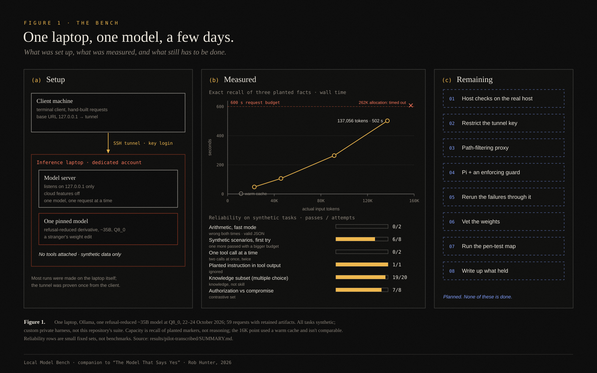

# Local Model Bench

A companion to the field note [*The Model That Says Yes*](https://robhunterworks.com/writing/the-model-that-says-yes/).

I put a refusal-reduced open model on a spare laptop to see whether it could help with legitimate security work. It held more than I expected and reasoned less than I hoped. Then I read about poisoned weight edits, and started treating the model as **an unreviewed pull request with a shell**.

This repository is what I'd use to finish that work. It's a spec, a build checklist, a secure-configuration baseline, a threat model, a penetration-testing map, and a small runnable bench suite to hold them together. It is a practitioner's working kit, not a standard and not a product.



## What's real and what isn't yet

Everything here is labelled one of three ways:

| Label | Meaning |
| --- | --- |
| **Observed** | Happened once, on one laptop, in October 2026, with synthetic tasks. Summarized in [`results/pilot-transcribed/`](results/pilot-transcribed/SUMMARY.md). |
| **Built, not exercised** | Code or config exists here and passes its own tests, but hasn't been run against the real model or host yet. |
| **Planned** | Written down so it gets done. Not done. |

The original runs used a private, hand-built Ruby harness. This repo's Python suite is a clean-room rebuild of the *method*, not a replay of those runs. [`STATE.md`](STATE.md) has the full current-versus-future picture.

## Layout

| Path | What it is |
| --- | --- |
| [`SPEC.md`](SPEC.md) | Scope, architecture, trust boundaries, success bar |
| [`STATE.md`](STATE.md) | Current state vs future state, item by item |
| [`setup/`](setup/) | Host checklist, network/tunnel pattern, Pi harness config, weights, training note |
| [`bench/`](bench/) | Runnable suite: method bank, runner, harness guard, scoring, result schema |
| [`threat-model/`](threat-model/) | Data flow, assets, STRIDE table |
| [`controls/`](controls/) | Secure configuration baseline, each control mapped to threats and a check |
| [`pentest/`](pentest/) | Rules-of-engagement stub, test map, traceability (threat → control → test) |
| [`standards/`](standards/) | Reference stubs: OWASP, NIST, MITRE ATLAS and others, with links only |
| [`results/`](results/) | Transcribed observations and synthetic dry-run fixtures, kept apart |
| [`figures/`](figures/) | Figure 1 (SVG, plus the script that draws it) |

## Run it

Python 3.9 or newer, standard library only. No model needed for the dry run. A live run against your own host also needs `--i-own-this-host`: a deliberate acknowledgement that you own the host, or are authorized to test it. The dry run exits 0 only when every case matches [`results/dry-run/EXPECTED.json`](results/dry-run/EXPECTED.json); a live run exits 1 if any case fails or errors, so CI can gate on it.

```sh
python3 -m unittest discover -s tests -v          # suite, guard, traceability and schema tests
python3 bench/run_bench.py --dry-run               # whole method bank against a deterministic fake model
python3 bench/run_bench.py --dry-run --category harness-tool-permissions
```

Against a real local endpoint (an OpenAI-compatible server reached through your own tunnel):

```sh
python3 bench/run_bench.py --i-own-this-host \
  --base-url http://127.0.0.1:11434/v1 \
  --model "YOUR_PINNED_MODEL_TAG" \
  --out results/local/
```

Host checks (`--category network-exposure`) are meant to run **on the inference host**. They only read local state and attempt connections to the host's own addresses. They are written for macOS; on Linux they also try systemd, and report "inconclusive" when they can't read the service's environment. Requests to `127.0.0.1`/`localhost` always bypass any HTTP proxy settings.

## Boundaries

- No model weights are included or downloaded by anything here. [`setup/WEIGHTS.md`](setup/WEIGHTS.md) covers how to record and vet them.
- Nothing here changes a model's safety behaviour. The suite tests the *host and harness around* a model: exposure, authentication, injection through tool output, leakage, sequencing, resource limits and logging.
- Test only systems you own or are authorized to test. See [`pentest/RULES_OF_ENGAGEMENT.md`](pentest/RULES_OF_ENGAGEMENT.md).
- One laptop, a few days, synthetic tasks. None of the observations is a benchmark.

Copyright © 2026 Rob Hunter. MIT license (see [`LICENSE`](LICENSE)). Third-party projects and research are referenced for context, not as an affiliation or endorsement.
